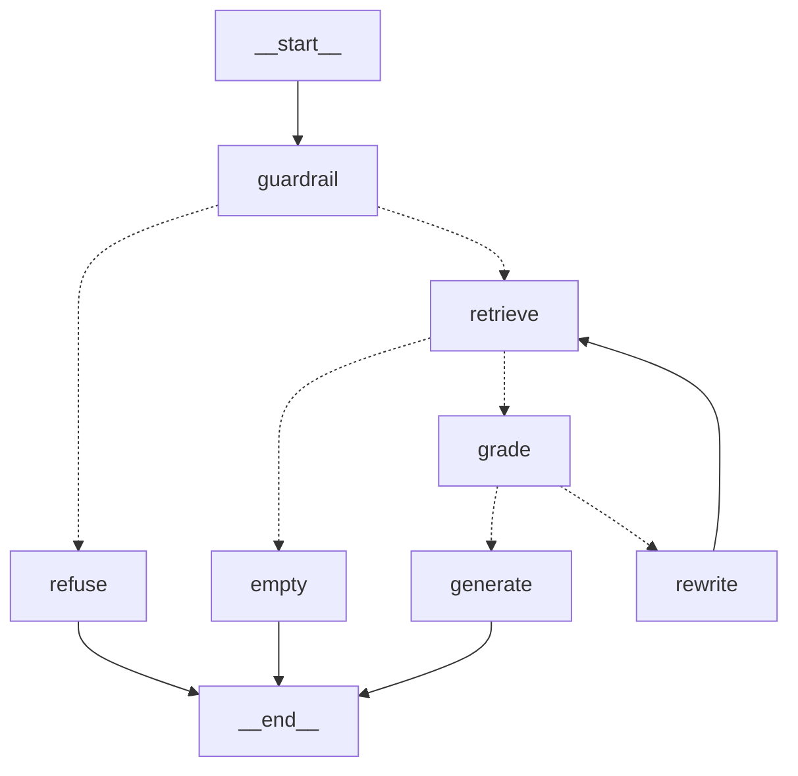

# Hybrid RAG Research Assistant

A production-style **Retrieval-Augmented Generation (RAG)** system over arXiv papers — hybrid search (BM25 + vectors), streaming answers with inline citations, Redis caching, and a built-in evaluation pipeline.


## Architecture

```
                    ┌─────────────────────────── Ingestion ───────────────────────────┐
 arXiv API ──▶ fetch metadata ──▶ download PDF ──▶ parse (PyMuPDF) ──▶ chunk (overlap)
                                                                        │
                                              Gemini embeddings ◀───────┘
                                                   │
                        ┌──────────────────────────┼─────────────────────────┐
                        ▼                          ▼                         ▼
                  PostgreSQL 16             OpenSearch 2.19            (vectors in kNN index)
                 paper/chunk metadata      BM25 text + knn_vector
                        │                          │                         │
                        └────────────┬─────────────┘                         │
                                     ▼                                       │
                          Hybrid retrieval (RRF fusion) ◀── query embedding ─┘
                                     │
                       ┌─────────────┼──────────────┐
                       ▼             ▼              ▼
                   Redis cache   Gemini LLM    Gradio UI
                  (exact match)  (streaming)   (chat + citations)
```

## Features

- **Hybrid search**: BM25 keyword + dense vector retrieval fused with Reciprocal Rank Fusion
- **Streaming RAG**: Server-Sent Events token streaming with numbered inline citations `[1]`, `[2]`
- **Injection guardrail**: before any retrieval, a regex refuses known prompt-injection phrasings ("ignore previous instructions", "system prompt", "you are now"), the question is escaped inside a delimited `<user_question>` block, and an LLM domain gatekeeper refuses off-topic questions (`src/services/agent_graph.py`)
- **Grounding guardrail**: model answers only from retrieved context; says "not found" otherwise
- **Corrective RAG (CRAG) loop**: an LLM grader classifies every retrieved chunk (`correct` / `ambiguous` / `incorrect`); if none pass, a query rewriter expands terminology and retrieval retries once. The full trace (grades, rewritten query, correction status) is returned in every response via the `crag` field. When correction fails too, the system refuses rather than hallucinates.
- **Resilient providers**: LLM generation supports Gemini and OpenCode Zen free models with automatic model failover; embeddings use Gemini with per-model daily-quota detection, a fallback chain, disk caching, and graceful degradation to BM25-only retrieval when quota is exhausted.
- **Caching**: exact-match Redis cache on (question, top_k) — repeat queries return instantly
- **API-key auth & rate limiting**: when `API_KEY` is set, every `/api/v1/*` route requires a matching `X-API-Key` header, and a per-IP sliding-window limiter (`RATE_LIMIT_RPM`, default 60/min) runs on Redis sorted sets, with an in-memory fallback if Redis is down (`src/services/auth.py`)
- **Evaluation harness**: golden Q&A dataset, keyword recall + LLM-judged faithfulness metrics; offline retrieval metrics Hit@k, MRR, precision/recall@k and NDCG@k with paper-level deduplication, so several chunks from one paper count once (`evals/metrics.py`)
- **Regression gate**: `evals/regression.py` compares a candidate run with a baseline and flags a regression on a >5% relative drop in MRR or Hit@k, or a >25% latency increase
- **Containerized**: one `docker compose up` starts everything
- **Observability**: OpenTelemetry tracing (spans for retrieval, embedding, agent nodes) + metrics (latency, cache hits, token counts) exported via OTLP to Jaeger/Grafana/Zipkin

## Quick start

```bash
git clone <repo-url>
cd rag-project

cp .env.example .env        # add your GEMINI_API_KEY from https://aistudio.google.com

docker compose up --build -d
```

Ingest some papers (first run downloads + indexes ~5 papers, ~1–2 min):

```bash
uv sync
uv run python scripts/ingest.py --query "ocean mesoscale eddies" --max-results 5
```

Launch the chat UI:

```bash
uv run python gradio_app.py     # open http://localhost:7861
```

## Services

| Service | URL | Purpose |
|---|---|---|
| API docs | http://localhost:8000/docs | Interactive OpenAPI explorer |
| Health check | http://localhost:8000/health | Postgres / OpenSearch / Redis status |
| Chat UI | http://localhost:7861 | Gradio interface with source panel |

## API

| Endpoint | Method | Description |
|---|---|---|
| `/api/v1/papers/ingest` | POST | Fetch + parse + chunk + embed + index arXiv papers |
| `/api/v1/papers` | GET | List indexed papers |
| `/api/v1/search` | POST | Search: `"mode": "bm25" \| "vector" \| "hybrid"` |
| `/api/v1/ask` | POST | RAG answer + citations (JSON) |
| `/api/v1/ask/stream` | POST | SSE token stream (`sources` → `crag` → `guardrail` → `token*` → `done`) |

Example:

```bash
curl -X POST http://localhost:8000/api/v1/ask \
  -H "Content-Type: application/json" \
  -d '{"question": "How do mesoscale eddies affect heat transport?", "top_k": 6}'
```

## Evaluation

The system is evaluated on `evals/golden_dataset.jsonl`:

- **keyword_recall** — fraction of expected key terms present in the answer
- **faithfulness** — Gemini-as-judge score that every claim is supported by retrieved context (anti-hallucination metric), reported 0→1
- **latency** and cache behaviour per question

```bash
uv run python evals/evaluate.py                # full eval with judge
uv run python evals/evaluate.py --skip-judge   # fast, no extra LLM calls
```

Results land in `evals/results.json`. Metric definitions follow standard RAG evaluation practice (Ragas-style faithfulness/context relevance).

## Tests

```bash
uv run pytest tests/ -v
```

63 tests covering chunking invariants (size bounds, empty input), RRF fusion semantics (dual-list boost, ordering), CRAG grading/rewrite routing, LangGraph compilation, embedding cache, reranker, LLM context formatting, and the evaluation/regression framework (metrics, deduplication, judge isolation) — all offline, no network required.

## Configuration

All via `.env` — see `.env.example`. Key settings:

| Variable | Default | Purpose |
|---|---|---|
| `GEMINI_API_KEY` | — | Required. Free from Google AI Studio |
| `LLM_PROVIDER` | `gemini` | `gemini` or `zen` (OpenCode Zen free models) |
| `ZEN_API_KEY` / `ZEN_MODEL` / `ZEN_FALLBACK_MODELS` | — | Zen gateway config with automatic model failover |
| `GEMINI_CHAT_MODEL` | `gemini-3.5-flash-lite` | Swap any Gemini model without code changes |
| `GEMINI_EMBEDDING_MODEL` / `EMBED_FALLBACK_MODELS` | `gemini-embedding-001` / `gemini-embedding-2` | Per-model daily quotas; failed model auto-skipped |
| `EMBED_DIM` | 768 | Must match embedding model output |
| `TOP_K` / `CHUNK_SIZE` / `CHUNK_OVERLAP` | 6 / 1200 / 150 | Retrieval & chunking tuning |
| `API_KEY` | — | When set, `/api/v1/*` requires `X-API-Key` and rate limiting turns on |
| `RATE_LIMIT_RPM` | 60 | Requests per minute per client IP |

## Agentic layer (LangGraph)

`/api/v1/ask` is orchestrated by a LangGraph state machine — every question flows through explicit nodes with conditional edges:



- **guardrail** — regex injection filter, then an LLM domain gatekeeper; injection attempts and off-topic questions are refused *before* any retrieval cost
- **retrieve** — hybrid BM25+vector search (degrades to BM25-only if embedding quota is exhausted)
- **grade** — CRAG relevance grader labels every chunk `correct` / `ambiguous` / `incorrect`
- **rewrite** — conditional: if nothing usable and attempts remain, expands terminology and re-retrieves
- **generate** — answers only from correct/ambiguous chunks, with inline citations
- **refuse / empty** — honest termination paths

The full execution trace (per-chunk grades, rewritten query, correction status, refusal flag) is returned in the `crag` field of every response. Regenerate the diagram with:

```bash
uv run python -c "import sys; sys.path.insert(0,'.'); from src.services.agent_graph import build_agent_graph; print(build_agent_graph().get_graph().draw_mermaid())"
```

## Benchmark: chunking & retrieval ablation

Six chunking configurations × four retrieval modes (`bm25`, `vector`, `hybrid`, `hybrid_rerank`), evaluated on an 8-question golden set (`evals/golden_retrieval.jsonl`) with `BAAI/bge-base-en-v1.5` embeddings (24 runs in `evals/benchmark_results.json`; hybrid highlights below):

| Config | Strategy | Size / Overlap | Mode | hit@5 | MRR |
|---|---|---|---|---|---|
| win_600_o150 | sliding window | 600 / 150 | **hybrid** | 1.00 | **1.00** |
| win_1200_o0 | sliding window | 1200 / 0 | hybrid | 1.00 | 1.00 |
| win_1200_o150 | sliding window | 1200 / 150 | hybrid | 1.00 | 1.00 |
| para_1200_o0 | paragraph-aware | 1200 / 0 | hybrid | 1.00 | 1.00 |
| para_1200_o150 | paragraph-aware | 1200 / 150 | hybrid | 1.00 | 1.00 |
| para_2000_o300 | paragraph-aware | 2000 / 300 | hybrid | 1.00 | 1.00 |

**Findings**
- **Hybrid (BM25 ⊕ vector via RRF) achieved perfect MRR (1.00) on every configuration** — rank fusion consistently placed the correct paper first where either single mode occasionally ranked it 2nd–3rd (BM25 MRR 0.92–0.94, vector 0.91–1.00).
- **Hybrid stays fast:** mean retrieval latency per configuration was 121–156 ms (about 140 ms on average) for hybrid. Adding the cross-encoder reranker (`hybrid_rerank`) cost 1.2–10 s and bought nothing: hybrid was already at 1.00, and reranking dropped one configuration to 0.917.
- **Caveat on scale:** the golden set is 8 questions over 8 papers, so a perfect MRR here shows that fusion fixes the single-mode misses. It is not a claim about large-corpus retrieval quality.
- Chunk size/overlap barely moved *paper-level* retrieval on this small corpus (hit@5 saturated at 1.0) — expected at 8 documents; differentiation would appear at scale.
- Overlap mattered more than strategy for vector mode: 1200/150 reached MRR 1.00 while zero-overlap variants sat at 0.92.

Reproduce:

```bash
uv run python evals/make_golden.py                                  # generate golden Q->paper pairs
uv run python evals/retrieval_benchmark.py --embed-model "local:BAAI/bge-base-en-v1.5"
```

Embedding providers are pluggable per run: Gemini models (quota-aware, automatic daily-quota fallback chain), or any `local:<sentence-transformers-model>` for unlimited offline evaluation.

## Design notes

- **Why hybrid search?** BM25 catches exact terminology ("Agulhas leakage"), vectors catch paraphrases ("warm ocean swirls"); RRF fuses both rank lists without score normalization issues.
- **Why store chunks in both Postgres and OpenSearch?** Postgres owns relational truth (papers ↔ chunks); OpenSearch owns search. Each tool does one job.
- **Cache key = hash(question, top_k)** so retrieval parameters participate in cache identity.

## Roadmap

- [x] Corrective RAG: document grading + query rewriting with correction traces
- [x] Multi-provider LLM/embedding abstraction with failover
- [ ] GraphRAG: entity/relation extraction over corpus for multi-hop domain questions
- [ ] Domain mode: geospatial metadata extraction for ocean/atmosphere literature
- [ ] Ragas integration for standardized benchmark reports

## Acknowledgments

Learning path inspired by the [Production Agentic RAG course](https://github.com/jamwithai/production-agentic-rag-course) by Shirin Khosravi Jam & Shantanu Ladhwe. All architecture decisions, code, evaluation harness and provider-resilience engineering in this repository were implemented independently — see the benchmark section for where this build goes beyond the course material.
